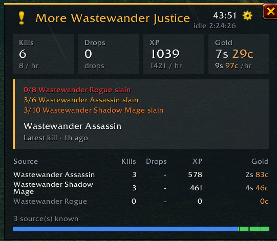
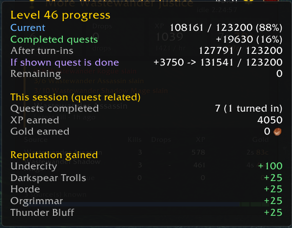

# Quest Mob Tracker

A WoW Forever addon that tracks the quest you're working on: which mobs (or world objects) are tied to it, kills, drops, XP, gold and time.

## Install

Install it from [CurseForge](https://www.curseforge.com/wow/addons/quest-mob-tracker), or copy this folder to `World of Warcraft\_forever_\Interface\AddOns\QuestMobTracker\`.

Questie is optional. If installed, its database is used to list the mobs and objects for each quest, and to show where a quest is handed in. Auctionator is optional too, for item values in the tooltips.

## What it shows

- Kills, drops, XP, gold and time for the quest in focus, plus a per-source table.
- The quest's objectives, coloured from red to green as they near completion. Kill, item, object and reputation objectives are tracked.
- Quests with nothing to count, such as escort and "speak with" quests, show their objective text instead, with the hand-in location when Questie has it.
- The time left on timed quests, in amber and then red in the last five minutes. It stays up until the quest is handed in.
- Items that are made by using another item, like turning an Untested sample into an Acceptable one, are tied back to the mobs that dropped the first item.
- A level bar along the bottom: current XP, XP from finished quests, and a preview of the focused quest's reward. Hover it for the session totals, including the reputation gained.

The window follows the quest focused in the game's tracker. Use `/qmt focus` to lock it to one.

## Commands

- `/qmt show` and `/qmt hide` show or hide the window.
- `/qmt config` opens the settings window: size, background opacity, locking the window, and the chat messages. The gear button on the window does the same.
- `/qmt focus <quest>` locks the window to a quest by name. `/qmt focus` on its own goes back to following the game's tracker.
- `/qmt scale <n>` makes the window bigger or smaller, from 0.4 to 2, for example `/qmt scale 1.2`.
- `/qmt alpha <n>` sets how see-through the window is, from 0 to 1.
- `/qmt reset` clears all the tracked sessions and starts fresh.
- `/qmt history` lists the quests you've finished.
- `/qmt kills` shows how your kills were counted. Useful when a kill seems to be missing.
- `/qmt trace` prints a chat line each time a kill or turn-in is counted, and which method caught it.
- `/qmt debug` prints the addon version and what the quest log returns. Handy for bug reports.
